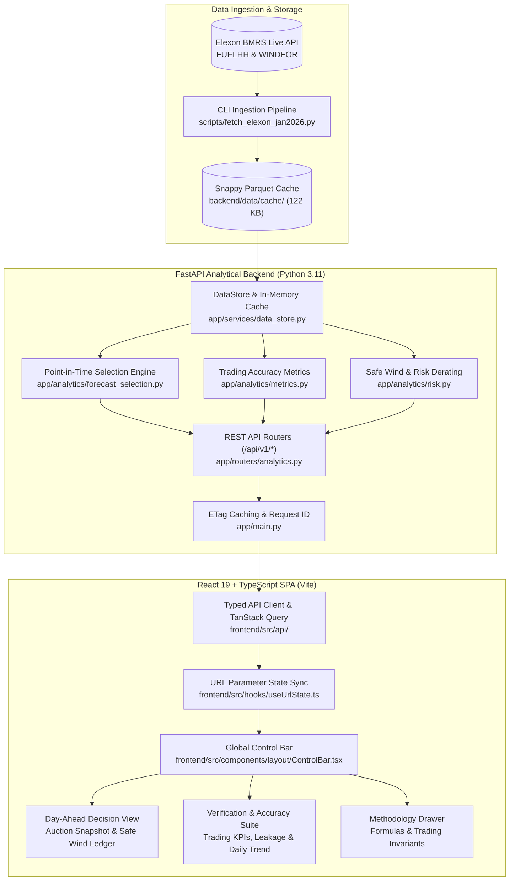

# System Architecture & Technical Specifications

The **UK Wind Forecast Decision Tool** is designed for day-ahead power trading desks operating in the GB electricity market. It evaluates National Grid ESO wind power forecasts (`WINDFOR`) against metered settlement generation (`FUELHH`) across January 2026.

---

## 1. High-Level Architecture Diagram



---

## 2. Directory & Module Map

```
UK weather forecast/
├── .github/
│   ├── workflows/ci.yml             # GitHub Actions CI/CD (Ruff, Mypy, Pytest, Oxlint, Vitest, Docker)
│   ├── pull_request_template.md     # PR description & trading checklist
│   └── CODEOWNERS                   # Critical path ownership specifications
├── backend/
│   ├── app/
│   │   ├── analytics/
│   │   │   ├── forecast_selection.py# Point-in-time selection with D-1 cutoff & horizon modes
│   │   │   ├── metrics.py           # MAE, RMSE, Bias, Percentiles, Lags, Profiles
│   │   │   └── risk.py              # Safe wind derating, buffer decomposition, backtests
│   │   ├── models/schemas.py        # Pydantic v2 schemas for all API payloads
│   │   ├── routers/analytics.py     # FastAPI endpoints under /api/v1/*
│   │   ├── services/data_store.py   # Parquet loader & in-memory pyarrow cache
│   │   ├── config.py                # Pydantic BaseSettings & environment configs
│   │   └── main.py                  # FastAPI app factory, ETag middleware, SPA static mount
│   ├── data/cache/                  # Canonical January 2026 Parquet cache (122 KB total)
│   ├── tests/                       # 92 unit, regression, invariant & property tests
│   ├── Dockerfile                   # Multi-stage production backend container
│   └── requirements.txt             # Pinned backend dependencies
├── frontend/
│   ├── src/
│   │   ├── api/                     # TanStack Query hooks & RFC 7807 fetch client
│   │   ├── components/ui/           # Accessible UI primitives (MetricCard, SegmentedControl, etc.)
│   │   ├── features/
│   │   │   ├── decision/            # Day-Ahead Decision View, Hero Chart, Safe Wind Ledger
│   │   │   ├── accuracy/            # Verification Suite, KPI cards, Leakage Trend, Histograms
│   │   │   └── methodology/         # Interactive Methodology drawer & domain formulas
│   │   ├── test/                    # 37 Vitest unit & integration tests + MSW mock server
│   │   └── types.ts                 # Full TypeScript definitions matching OpenAPI schemas
│   ├── e2e/smoke.spec.ts            # Playwright browser end-to-end user flow
│   ├── Dockerfile                   # Multi-stage production frontend container
│   └── package.json                 # Pinned frontend dependencies
├── scripts/
│   ├── fetch_elexon_jan2026.py      # Resilient BMRS ingestion chunker
│   └── smoke_test.py                # Automated post-deployment verification script
├── docs/
│   ├── DEPLOYMENT_GUIDE.md          # Step-by-step Vercel & Heroku deployment guide
│   ├── decisions.md                 # Architectural Decision Records (ADRs)
│   └── METHODOLOGY.md               # Mathematical formulation of metrics and risk
├── Dockerfile                       # Unified single-origin production container (FastAPI + React)
├── docker-compose.yml               # Unified dev (hot reload) and prod orchestration
└── README.md                        # Master project documentation
```

---

## 3. Quantitative Core & Invariants

### 1. Causal Point-in-Time Selection
For every target settlement interval start time $t \in \text{January 2026}$, the decision forecast $F_{\text{decision}}(t)$ is selected as:
$$F_{\text{decision}}(t) = \text{Latest } F(t, p) \quad \text{subject to } p \le t_{\text{cutoff}}$$
where $t_{\text{cutoff}} = \text{DeliveryDate} - \text{offset} \text{ at } H_{\text{cutoff}}$.
Default: 09:00 UTC on D-1.

### 2. Trading Error Formulation
$$\text{Error}(t) = F(t) - A(t)$$
$$\text{Shortfall}(t) = \max(0, F(t) - A(t))$$
- Over-forecast ($\text{Error} > 0$): Shortfall penalty risk.
- Under-forecast ($\text{Error} < 0$): Surplus generation.

### 3. Buffer Decomposition
$$\text{Total Buffer} = Q_\alpha(\text{Shortfall}) = \text{Systematic Bias} + \text{Residual Quantile}$$
$$\text{Systematic Bias} = \frac{1}{N}\sum_{t=1}^N \text{Shortfall}(t)$$
$$\text{Residual Quantile} = \max\left(0, Q_\alpha(\text{Shortfall}) - \text{Systematic Bias}\right)$$
$$\text{Safe Wind}(t) = \max\left(0, F(t) - \text{Total Buffer}\right)$$
$$\text{Replacement Reserve}(t) = \min\left(F(t), \text{Total Buffer}\right)$$
